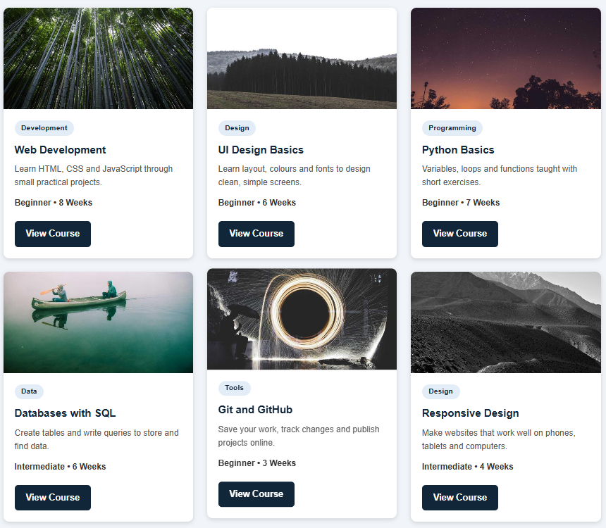
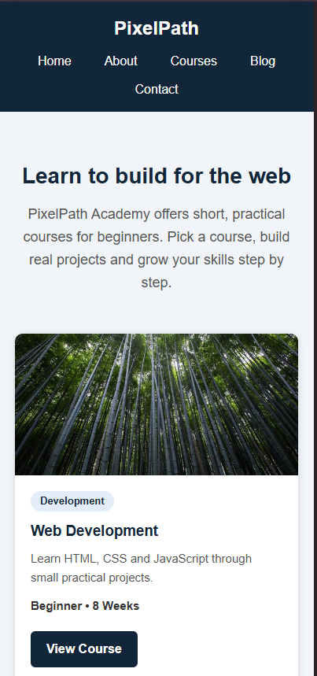

HTML & CSS — Navigation Bar and Responsive Card Design

1. Student Information

Name:Ranjan Ghimire
Student ID: 2540836
Course: BscSE
Leve: Level 4
Assignment: HTML & CSS Practical Assignment

2. Project Description

This project is a responsive webpage created using HTML and CSS. The main purpose of the project is to demonstrate how to create a navigation bar, design reusable cards, arrange multiple cards in a responsive layout, and create a simple complete webpage.

The webpage contains a navigation bar, an introduction section, six cards and a footer. CSS was used to control the colours, spacing, typography, layout, hover effects and responsive behaviour.

3. Technologies Used
* HTML5
* CSS3
* CSS Flexbox
* CSS Grid
* Responsive CSS
* Visual Studio Code
* Google Chrome
* GitHub

4. Learning Resources

a. University Lecture Materials
Topic: HTML Structure and CSS Basics
What I learned:I learned how HTML is used to structure a webpage and how CSS is used to style HTML elements.
How I applied it: I used HTML elements such as `<header>`, `<nav>`, `<main>`, `<section>`, and `<footer>`. I also used CSS to add colours, spacing, fonts, and layouts.

b. MDN Web Docs
Topic:Semantic HTML and CSS
What I learned: I learned how semantic HTML elements make the structure of a webpage clearer and how CSS selectors are used to style elements.
How I applied it: I used semantic elements such as `<nav>`, `<main>`, and `<footer>` and used different CSS selectors for the navigation bar and cards.

c. MDN Web Docs
Topic: Flexbox and CSS Grid
What I learned: I learned how Flexbox and Grid can be used to arrange webpage elements.
How I applied it: I used Flexbox to arrange the navigation bar and CSS Grid to arrange the six course cards.

d. YouTube Tutorial
Topic: Responsive Web Design
What I learned: I learned how websites can change their layout depending on the screen size.
How I applied it: I used media queries to display three cards on desktop, two cards on tablets, and one card on mobile devices.

5. Screenshots

a.Navigation Bar

The navigation bar contains the website name and navigation links. CSS Flexbox was used to align the navigation items, and hover effects were added to make the links interactive.

b. Card Design

The cards contain an image, title, description, additional information and a button. CSS was used to control the card size, spacing, typography and appearance.

c.Card Layout

Six cards are displayed using a responsive layout. The cards have consistent spacing and styling.

d.Responsive Design

The webpage was tested at a smaller screen size. The card layout changes to fit the available screen width, making the webpage easier to use on mobile devices.

6. Key Concepts Learned

Semantic HTML

I learned that semantic HTML elements describe the purpose of webpage content. For example, `<nav>` is used for navigation links, while `<header>` and `<footer>` are used for the top and bottom sections of a webpage.

CSS Selectors

I learned that CSS selectors are used to select HTML elements that need styling. I used selectors to style the navigation, cards, buttons and other sections.

Box Model

I learned that every HTML element can be understood using the CSS box model, which includes content, padding, border and margin. I used padding and margin to create proper spacing.

Flexbox

I learned that Flexbox is useful for arranging elements in a row or column and controlling their alignment. I used Flexbox to arrange the navigation items.

CSS Grid

I learned that CSS Grid is useful for creating layouts with rows and columns. I used Grid to arrange the six cards.

Hover Effects

I learned how the `:hover` pseudo-class can change the appearance of an element when the mouse is placed over it. I applied hover effects to navigation links and cards.

Responsive Design

I learned that responsive design allows a webpage to adjust according to the screen size. I used CSS media queries to change the card layout for desktop, tablet and mobile screens.

7. Challenges and Solutions

Challenge 1 — Aligning the Navigation Items

At first, it was difficult to place the navigation links properly in one row with suitable spacing. I solved this by learning about CSS Flexbox and using `display: flex` with alignment and spacing properties.

Challenge 2 — Making the Cards Responsive

Another challenge was making the six cards fit properly on different screen sizes. I solved this by using CSS Grid and media queries. The layout displays three cards per row on larger screens, two cards per row on medium screens and one card per row on smaller screens.

8. AI Usage Disclosure

I used ChatGPT as a learning and support tool during the development of this assignment. It was used to understand HTML and CSS concepts, clarify errors, and help me understand how different CSS properties work.

I reviewed and modified the implementation myself and made sure that I understood the code used in the project.

9. GitHub Repository

Repository:
https://github.com/ranjanghimire044-droid/html-css-assignment.git

 10. Conclusion

This project helped me improve my understanding of HTML structure and CSS styling. I learned how to create a semantic navigation bar, design reusable cards, use Flexbox and Grid, apply hover effects and create a responsive webpage. I also learned how to document my learning process and present my project using GitHub.
